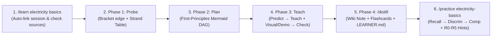

# learn

A compounding AI learning harness built on [pi](https://github.com/earendil-works/pi) and [Obsidian](https://obsidian.md).

Originally forked from [amosblomqvist/learn](https://github.com/amosblomqvist/learn) ([video](https://www.youtube.com/watch?v=kzcI5F4tGiU)) and upgraded with the best pedagogical mechanics from [amosblomqvist/learnharness](https://github.com/amosblomqvist/learnharness), [Karpathy's LLM Wiki](https://gist.github.com/karpathy/442a6bf555914893e9891c11519de94f) compilation, [Feynman Role-Reversal](https://github.com/koukekoukej-glitch/feynman-tutor) teach-backs, and [Obsidian Spaced Repetition](https://github.com/st3v3nmw/obsidian-spaced-repetition) — **all running natively inside `pi` + Obsidian with zero external apps to maintain.**

---

## Documentation Map

To keep each concept clear and focused, our documentation is split into targeted guides:

- **[Guided Walkthrough: Learning *Electricity Basics* (`docs/walkthrough-electricity-basics.md`)](docs/walkthrough-electricity-basics.md)** — Follow a complete, concrete learning journey from `/learn electricity basics` through probing, dependency mapping, interactive simulations, distilling, and `/practice`.
- **[Teaching Methodology (`docs/teaching-methodology.md`)](docs/teaching-methodology.md)** — The two core principles (*Unconditional Truths First* + *Motivated Discovery*), High-Entry Binary Search Probing, the `Predict → Teach → Check` loop, and the Confidence × Correctness diagnostic matrix.
- **[Deliberate Practice & The Hint Ladder (`docs/deliberate-practice.md`)](docs/deliberate-practice.md)** — How `/practice` trains deployment from the inactive state across *Recall → Discrimination → Composition* using pre-committed solutions and the `R0`–`R5` Hint Ladder.
- **[Interactive Tools & Subagents (`docs/tools-and-subagents.md`)](docs/tools-and-subagents.md)** — How `quiz`, `explain` (anti-sycophancy free recall), `mermaid-maker`, `svg-maker`, `demo-maker` (interactive HTML/Canvas sliders), `pdf-reader`, and `researcher` work under the hood.
- **[Obsidian Vault Architecture (`docs/vault-architecture.md`)](docs/vault-architecture.md)** — How `LEARNER.md`, `concepts/`, `sessions/`, `flashcards/`, `vocab/`, and `viz/` compound across days, languages (English ↔ Ukrainian), and computers.

---

## The Road to Learning a Topic (Quick Scenario: *Electricity Basics*)

Here is what learning a topic looks like from start to finish (see the [full annotated walkthrough](docs/walkthrough-electricity-basics.md) for every screen and callout):



### Step 1 — Launch `/learn electricity basics` (`Phase 0`)
You open `pi` inside your Obsidian vault and run:
```text
/learn electricity basics
```
- **Auto-Linking:** `pi` immediately links `sessions/electricity-basics.md` via `link_session_log`. Keep that note open side-by-side in Obsidian — every explanation, LaTeX formula, diagram, interactive slider demo, and quiz renders live as you go.
- **Memory & Curated Sources:** `pi` reads `LEARNER.md` (so it knows what you already know across other domains) and checks `raw/curated-sources.md` for any saved articles on electricity.

### Step 2 — Find Your Exact Edge (`Phase 1: Probe`)
Before teaching a single word, `pi` clarifies your goal via `ask_user_question` (*"I want to understand voltage, current, resistance, and why household circuits are wired in parallel"*), then binary-searches your prerequisite knowledge using graded `quiz` popups (`type: "probe"`):
- In the terminal `quiz` popup, you pick your answer, set your **Confidence (`30% | 50% | 70% | 90% | 100%`)** using `←`/`→`, and optionally type your reasoning in the **Thinking** box.
- Because you answer a basic charge question with **90% confidence** (Correct + High), `pi` jumps difficulty sharply. When you pick a wrong option on voltage drop with **90% confidence** (Wrong + High = **Committed Misconception**), `pi` catches that you are conflating *voltage* (potential difference between two points) with *current* (charge flow through a point).
- Probing concludes with a **Strand Assessment Table** in your Obsidian log showing your exact **Floor**, **Ceiling**, and **Misconceptions** for each prerequisite strand.

### Step 3 — Approve the First-Principles Dependency Map (`Phase 2: Plan`)
`pi` dispatches the `researcher` subagent to verify foundational physics framings, then presents a minimal **Mermaid Dependency DAG** starting from unconditional truths:
- `Root 1`: Charge & Coulomb Repulsion → `Node 2`: Voltage as Potential Energy per Charge ($V = \Delta U / q$) → `Node 3`: Current as Flow Rate ($I = \Delta q / \Delta t$) → `Node 4`: Resistance & Ohm's Law ($I = V/R$) → `Goal`: Series vs. Parallel Household Circuits.
- Nothing begins until you approve the map.

### Step 4 — Build Understanding One Step at a Time (`Phase 3: Predict → Teach → Check`)
For each node on the map, `pi` runs a tight **Predict → Teach → Check** loop:
1. **Predict (`quiz` / `explain` with `type: "predict"`):** Before introducing parallel branches, `pi` asks: *"If you plug a 1000 W kettle into a series circuit with your desk lamp, what happens to the lamp's brightness?"* You attempt the discovery first.
2. **Teach (with Verified Visuals & Interactive Demos):**
   - `pi` resolves your prediction in clear, 3Blue1Brown-style prose (zero robotic meta-choreography).
   - When spatial geometry matters, `pi` calls `svg-maker` to draw a custom schematic of potential drops across series vs. parallel loads (`![[viz-parallel-drops-....png|500]]`).
   - When dynamic parameter behavior matters, `pi` calls `demo-maker` to build a **live interactive HTML/Canvas circuit simulator** (`<iframe src="viz/demo-ohms-law-....html">`) right inside your Obsidian note, telling you: *"Drag the Resistance $R_2$ slider from $100\ \Omega$ down to $5\ \Omega$ and watch how branch current $I_2$ spikes while voltage $V$ stays locked at $120\text{ V}$."*
3. **Check (`quiz` or `explain` with `type: "check"`):**
   - You verify the step landed by applying it to a novel circuit scenario.
   - For deeper checks, `pi` uses `explain` — committing its full reference derivation *before* you type your answer, then revealing its committed answer on submit and grading your explanation strictly (🔴 / 🟡 / 🟢) with zero sycophancy.

### Step 5 — Feynman Teach-Back & Distill to Vault (`Phase 4: /distill`)
Every 2 completed nodes (and when you reach the final goal node), `pi` nudges you to lock in your progress:
- You explain in 2 sentences why parallel outlets all see $120\text{ V}$ while series loads divide voltage.
- `pi` compiles the session into:
  - **`concepts/electricity-basics.md`** — Clean Karpathy-style atomic wiki note with your unconditional truths, Mermaid DAG, derivations, and embedded visuals/demos.
  - **`flashcards/physics.md`** — 3–7 active-recall cards formatted for the Obsidian Spaced Repetition plugin.
  - **`LEARNER.md` & `INDEX.md`** — Logs your mastered nodes, the dislodged voltage/current misconception, and your next frontier.

### Step 6 — Make Knowledge Deploy Cold (`/practice electricity-basics`)
Understanding a lesson when the concepts are fresh in working memory is different from having the right principle come to mind cold when facing an unfamiliar problem. Next day (even on a different computer after `git pull`), you run:
```text
/practice electricity-basics
```
- `pi` loads `concepts/electricity-basics.md` and poses problems using `explain({ type: "practice", ... })` **without announcing which formula or node applies**.
- Problems escalate across three demand modes: **Recall** → **Discrimination** (near-twin setups that trap your old voltage/current confusion) → **Composition** (multi-step circuit failures).
- If you get stuck mid-problem and click **"💡 I'm stuck / Check my work so far"**, `pi` does **not** spoil the answer — it reads your working trace and gives **one surgical rung from the Hint Ladder (`R0`–`R5`)** so you still generate the solution yourself.
- Any problem that needed heavy hints (`R3+`) or was missed is automatically **retested in a fresh surface scenario** before the session ends.

---

## Quick Setup on a New Machine

### 1. Prerequisites
- Install [pi](https://github.com/earendil-works/pi), [Obsidian](https://obsidian.md), and Google Chrome / Edge (used headlessly to render and verify diagrams, interactive demos, and PDF pages).
- *(Optional)* In Obsidian Community Plugins, install **Spaced Repetition** (`st3v3nmw/obsidian-spaced-repetition`) and **Dataview**:
  - In **Settings → Spaced Repetition → Flashcards**, set **Show context in cards: `OFF`**, **Bury sibling cards until the next day: `ON`**, and **Convert highlights to clozes: `ON`**.

### 2. Clone into `~/.pi/agent`
```bash
# Linux / macOS / Git Bash on Windows:
git clone https://github.com/YaroslavKormushyn/learn.git ~/.pi/agent

# PowerShell on Windows:
git clone https://github.com/YaroslavKormushyn/learn.git "$HOME\.pi\agent"
```

### 3. Install Visual & PDF Tool Dependencies
```bash
cd ~/.pi/agent/extensions/visual-tools
npm install
```

### 4. Start Learning in Your Obsidian Vault
```bash
cd /path/to/your/obsidian-vault
pi
```
Inside `pi`, run `/learn` (to pick from active topics) or `/learn <topic>`.

---

## Slash Commands Reference

| Command | Description |
| :--- | :--- |
| `/learn [topic]` | Start or resume a structured learning session (shows an interactive topic picker if `[topic]` is omitted; auto-links `sessions/<slug>.md`) |
| `/practice [topic-or-file]` | Run a deliberate problem-solving session (*Recall → Discrimination → Composition* + `R0–R5` Hint Ladder + fresh-surface retests) |
| `/feynman [topic]` | Role-reversal teach-back using pre-committed `explain` prompts: explain the mechanism in your own words to expose blind spots (🔴 / 🟡 / 🟢) |
| `/distill [topic-slug]` | Compile the session into `concepts/<topic>.md`, `flashcards/<domain>.md`, and `LEARNER.md` |
| `/review-vault [topic]` | Quick diagnostic & scenario review session across your vault targeting historical misconceptions |
| `/vocab <word-or-phrase>` | Create/enrich an atomic vocabulary note in `vocab/<lang>/<word>.md` with etymology & flashcards |
| `/md-log [topic]` | Manually link/switch the live session log in `sessions/` (rarely needed since `/learn` and `/practice` auto-link) |
