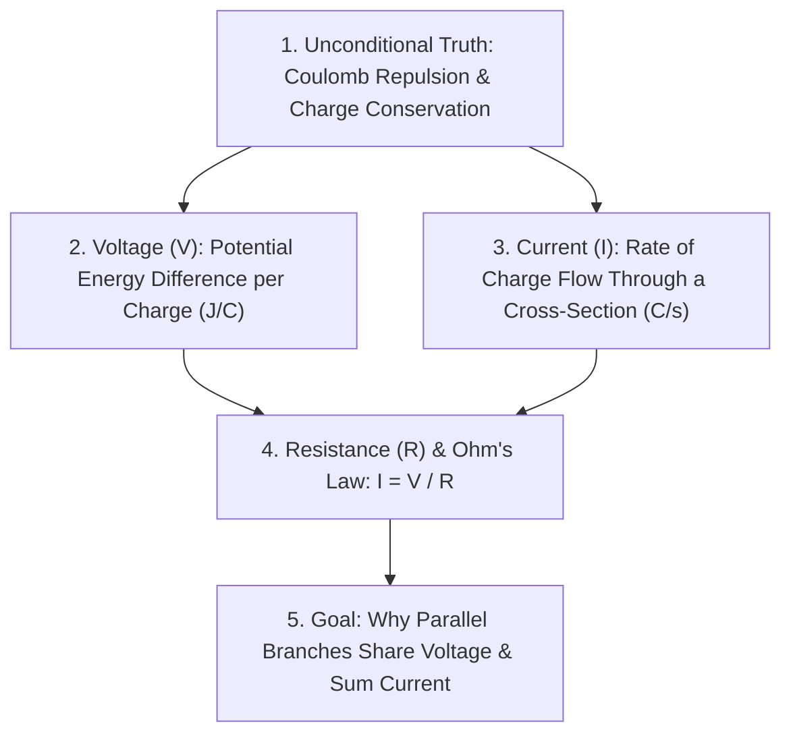

# Guided Walkthrough: Learning *Electricity Basics* from Zero to Mastery

This walkthrough follows a single concrete topic — **Electricity Basics** (`electricity-basics`) — through every stage of our learning harness so you can see exactly how `pi` and Obsidian work together.

---

## Stage 1 — Starting the Session (`/learn electricity basics`)

Open a terminal inside your Obsidian vault folder, start `pi`, and run:

```text
/learn electricity basics
```

### What happens automatically (`Phase 0`):
1. **Reads Persistent Vault Memory:** `pi` reads `LEARNER.md` and `INDEX.md` to check if `electricity-basics` is already in progress and what mental models you already hold.
2. **Auto-Links the Live Obsidian Log:** `pi` calls `link_session_log({ topic_slug: "electricity-basics" })`, creating `sessions/electricity-basics.md` and showing `🗒 electricity-basics.md` in your terminal status bar.
   - **Tip:** Open `sessions/electricity-basics.md` in Obsidian right next to your terminal. Everything `pi` writes — `$LaTeX$` formulas, Mermaid graphs, custom SVGs, interactive HTML sliders, and quiz callouts — appears live in Obsidian.
3. **Checks Curated Sources:** `pi` searches `raw/curated-sources.md` for saved links matching `electricity`, `voltage`, or `circuit`. If it finds any, it pops up an `ask_user_question` checklist so you can choose which saved articles to weave into the lesson.

---

## Stage 2 — Finding Your Edge (`Phase 1: Probe`)

Before teaching anything, `pi` must bracket **what you want to learn** (your goal) and **where your current understanding ends** along each prerequisite strand.

### 1a. Clarifying Your Goal (`ask_user_question`)
`pi` pops up an ungraded `ask_user_question` menu in the terminal:
> **What is your concrete goal for learning electricity basics?**
> 1. **Understand voltage, current, resistance, and how everyday household/DC circuits work from first principles (Recommended)**
> 2. **Prepare for electronics / microcontroller circuit design (resistors, capacitors, Kirchhoff's laws)**
> 3. **Understand AC power distribution, transformers, and three-phase systems**
> 4. **Other (type your own)**

You select Option 1.

### 1b. Binary-Searching Your Edge (`quiz` with Confidence & Thinking)
Next, `pi` probes your prerequisite strands using graded `quiz` popups (`type: "probe"`), **entering near the top** rather than wasting time on trivial questions:

```text
────────────────────────────────────────────────────────────────────────────
 🔎 PROBE (Finding Your Edge)
 Two identical 10 Ω resistors are connected in parallel across an ideal 12 V
 battery. A third 10 Ω resistor is then added in parallel with the first two.
 What happens to the current through the first resistor and the total current
 drawn from the battery?

 > 1. Current through R₁ stays 1.2 A; total battery current increases from 2.4 A to 3.6 A.
   2. Current through R₁ drops to 0.8 A; total battery current stays constant at 2.4 A.
   3. Current through R₁ stays 1.2 A; total battery current drops because equivalent resistance rises.
   4. Current through R₁ increases to 1.8 A; total battery current increases to 5.4 A.

   I don't know
   Ask a question first (pause quiz)

 Confidence: 30%  50%  70%  [90%]  100%   90% (Confident)

 Thinking out loud / side question (optional — ↓ or Tab to focus):
 The battery pushes a fixed total current, so splitting it 3 ways should lower R₁'s current.
────────────────────────────────────────────────────────────────────────────
```

Suppose you pick **Option 2** with **90% confidence** (`←`/`→` keys) and write your reasoning in the thinking field.
- The TUI immediately grades your answer (`✗ Incorrect (Confidence: 90%)`), reveals that **Option 1** is correct, and shows the explanation.
- **How `pi` reads this signal:** `Wrong + 90% Confidence` + your thinking note reveals a **committed misconception**: you view a battery as a *constant-current pump* rather than a *constant-voltage (potential difference) source*.

After 3–4 adaptive probe questions across the prerequisite strands, `pi` concludes Phase 1 by writing a **Strand Assessment Table** into your session log:

| Strand | Floor (Already Held) | Ceiling (Where It Ends) | Misconceptions / Notes |
| :--- | :--- | :--- | :--- |
| **Electrostatic Charge** | Knows electrons carry negative charge and like charges repel | Unsure how electric field relates to potential energy | Solid foundation |
| **Voltage vs. Current** | Knows current $I$ is charge flow | Conflates voltage source with constant-current source | **Misconception:** Believes battery outputs fixed current $I$ regardless of load |
| **Ohm's Law & Networks** | Recognizes $V = I \cdot R$ algebraically | Cannot predict branch currents when parallel loads change | Needs physical grounding before network rules |

---

## Stage 3 — The First-Principles Plan (`Phase 2: Plan`)

`pi` runs the `researcher` subagent synchronously to verify clean pedagogical framings, then presents your custom **Dependency Map** in Obsidian and waits for your go-ahead:



You reply *"Looks good, let's go"* to start Phase 3.

---

## Stage 4 — Learning Node by Node (`Phase 3: Predict → Teach → Check`)

Instead of dumping a textbook lecture, `pi` walks the road **one reasoning step at a time** using the `Predict → Teach → Check` cycle.

### 1. Predict (`type: "predict"`)
Before explaining why parallel branches are independent, `pi` poses a motivating prediction question:
> **🔮 PREDICT:** Imagine a tall water tower whose water level is kept strictly at height $h = 10\text{ m}$ above the ground by a giant reservoir. Pipe A is already open at the bottom, spraying water at $2\text{ L/s}$. If you open a second identical Pipe B next to it, does the pressure at the entrance of Pipe A drop, or stay the same?

### 2. Teach (Prose + Custom Visuals + Interactive HTML Demo)
`pi` resolves your prediction and connects it to **Voltage ($V$)** as potential energy difference per unit charge ($1\text{ V} = 1\text{ J/C}$):
- **Static Schematic (`svg-maker`):** To show how potential drops along a wire, `pi` dispatches `svg-maker`, which renders, visually verifies, and embeds `![[viz-voltage-potential-drop-1730000000.png|500]]`.
- **Interactive Simulation (`demo-maker`):** When teaching Ohm's Law ($I = \frac{V}{R}$) and parallel loads, `pi` dispatches `demo-maker`, which builds a self-contained HTML/Canvas circuit simulator, verifies in headless Chrome that it has zero console/page errors, visually checks the screenshot, and embeds it inline in your Obsidian note:

```html
<iframe src="viz/demo-parallel-circuit-1730000000.html" width="100%" height="460" style="border:1px solid #d0d7de;border-radius:8px;background:#ffffff;"></iframe>
```

`pi` tells you:
> *"In your Obsidian note, drag the **Branch 2 Resistance ($R_2$)** slider from $100\ \Omega$ down to $5\ \Omega$. Watch how $I_2$ rises from $0.12\text{ A}$ to $2.40\text{ A}$ while the voltage across Branch 1 ($12\text{ V}$) and its current ($I_1 = 1.20\text{ A}$) don't budge at all."*

### 3. Check (`quiz` and Pre-Committed `explain`)
After each step, `pi` verifies that the idea actually landed using an applied check:
- **Multiple-choice check (`quiz` with `type: "check"`):** Tests whether you can apply the rule to a new circuit.
- **Anti-sycophancy free-recall check (`explain` with `type: "check"`):**
  `pi` calls `explain`, committing its full reference answer *before* you type a word:
  > **✓ CHECK YOUR UNDERSTANDING:** A homeowner plugs a $1500\text{ W}$ space heater and a $15\text{ W}$ LED lamp into the same $120\text{ V}$ wall outlet strip. In your own words, explain (1) how the voltage across the LED lamp compares to the voltage across the heater, and (2) why the circuit breaker trips if you add a toaster, even though the voltage stays $120\text{ V}$.

  When you submit your answer in the terminal `Editor`, the TUI immediately reveals `pi`'s **Committed reference answer** right below yours, and `pi` grades your explanation strictly (`🟢 Solid & locked in`).

---

## Stage 5 — Milestone Nudge, Feynman Teach-Back & `/distill` (`Phase 4`)

Every 2 completed nodes (and when you finish Node 5), `pi` pops up a checkpoint menu:
1. **Run a 60-second Feynman Teach-Back + Auto-Distill to Vault (Recommended)**
2. **Auto-Distill progress to Obsidian Vault now & continue**
3. **Keep going to the next node first**

When you choose Option 1 (or run `/distill` manually at the end of a session), `pi` compiles everything into three permanent vault files:

1. **`concepts/electricity-basics.md`** — A clean, structured Karpathy-style wiki note containing:
   - The **Unconditional Truths** at the root.
   - The **Mermaid Dependency Graph**.
   - Concise derivations, embedded diagrams (`![[viz-...png]]`), and your interactive simulation (`<iframe src="viz/demo-...html">`).
   - A **Dislodged Misconceptions** callout documenting the *Constant-Voltage vs. Constant-Current Source* trap so you never fall for it again.
2. **`flashcards/physics.md`** — 5 high-signal active-recall flashcards (`#flashcards/physics`) ready for Obsidian's *Spaced Repetition* plugin.
3. **`LEARNER.md` & `INDEX.md`** — Marks Nodes 1–5 `[x]` completed and suggests `/practice electricity-basics` as your next step.

---

## Stage 6 — Deliberate Problem Practice (`/practice electricity-basics`)

Understanding a concept when it was just explained is easy; having the right principle come to mind **cold** when looking at an unfamiliar problem is real mastery.

The next day, you open `pi` and run:

```text
/practice electricity-basics
```

1. **Unannounced Targets (The Inactivity Constraint):**
   `pi` reads `concepts/electricity-basics.md` and immediately poses Problem 1 via `explain({ type: "practice", ... })` **without** telling you which formula or node to use.
2. **Escalating Demand Modes (`Recall → Discrimination → Composition`):**
   - *Problem 1 (Recall):* Quick calculation of charge and energy transfer in a battery.
   - *Problem 2 (Discrimination):* Near-twin comparison between an ideal voltage source with internal resistance $r_{int}$ vs. an ideal source when a load shorts out.
   - *Problem 3 (Composition):* A multi-branch circuit where a fuse blows in one parallel leg and you must determine how the ammeter and voltmeter readings shift across the remaining network.
3. **The 6-Rung Hint Ladder (`R0`–`R5`):**
   Suppose you get stuck on Problem 3, write your partial setup in the editor, and select **"💡 I'm stuck / Check my work so far"**:
   - Because you requested a hint, the TUI **does not reveal `committedAnswer`**.
   - `pi` inspects your working trace, sees where you stalled, and gives a single **Rung `R1` hint**: *"Look at the total current leaving the node before the blown branch — what happened to the number of available conducting paths?"*
   - It then re-opens `explain` so you can finish the problem yourself!
4. **Fresh-Surface Retests:**
   Before ending the practice session, any problem where you needed a heavy hint (`R3+`) or missed the answer is automatically re-tested in a **new scenario** (e.g., thermal heating elements in a car rear-window defroster) to prove the skill transfers.

---

## Stage 7 — Long-Term Retention (`/review-vault`, Spaced Repetition, `/vocab`)

- **Daily Flashcards in Obsidian:** Click the *Review flashcards* icon in Obsidian's left ribbon to review your `#flashcards/physics` cards on an FSRS/SM-2 schedule.
- **Scenario & Misconception Review (`/review-vault electricity`):** Anytime weeks later, run `/review-vault electricity` for a 5-minute diagnostic check targeting your historical weak spots recorded in `LEARNER.md`.
- **Vocabulary Capture (`/vocab`):** Encountered an unfamiliar term in English, Ukrainian, or German while studying? Run `/vocab діелектрик` or `/vocab conductance` to generate an atomic word note in `vocab/<lang>/<word>.md` with etymology hooks and cloze flashcards.
